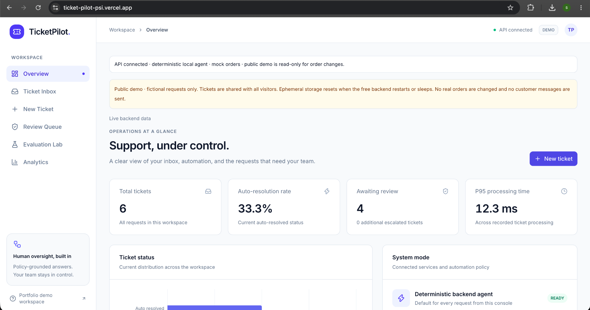
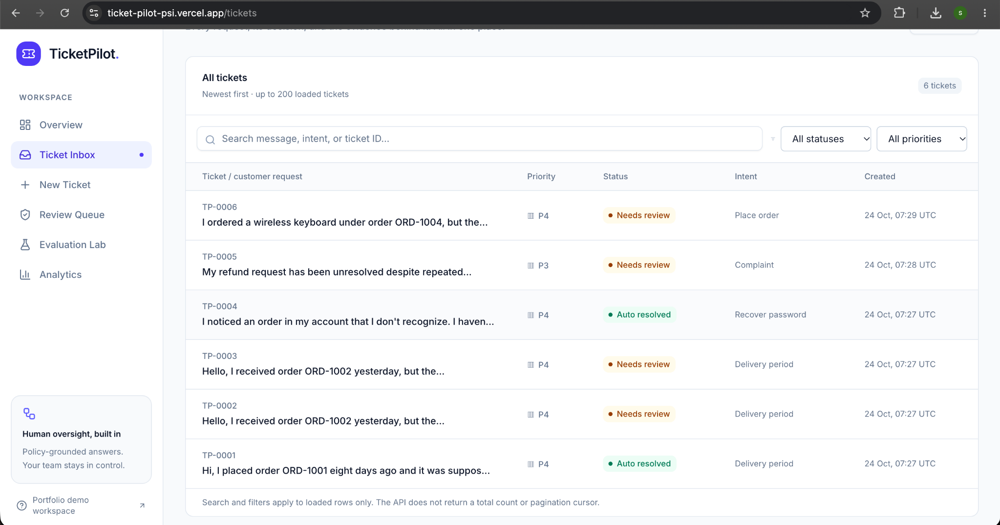
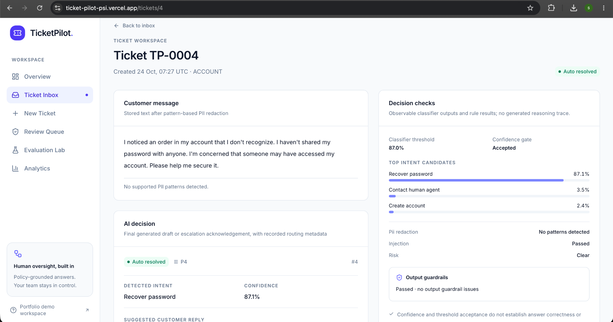
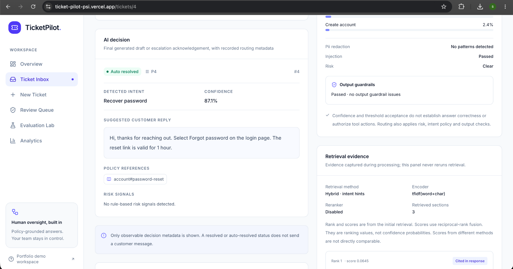
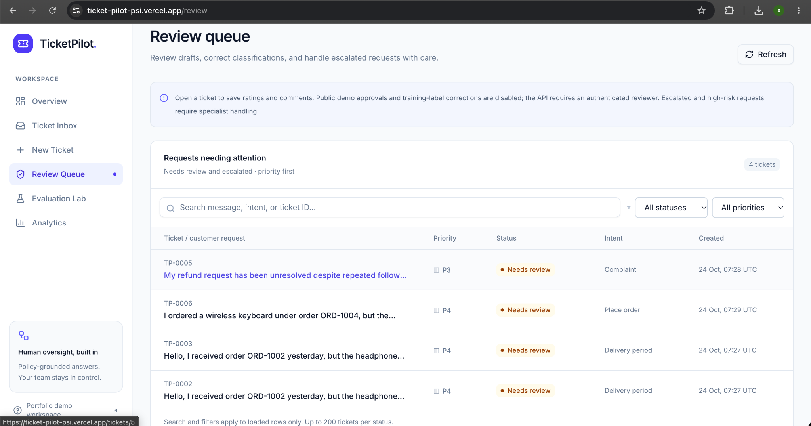
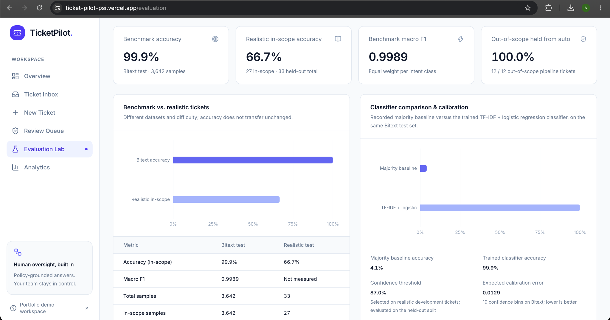
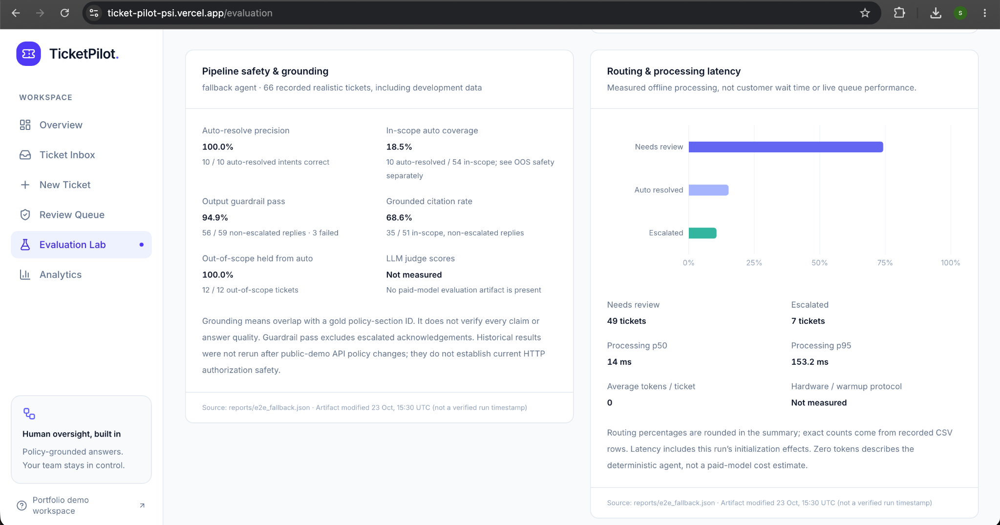
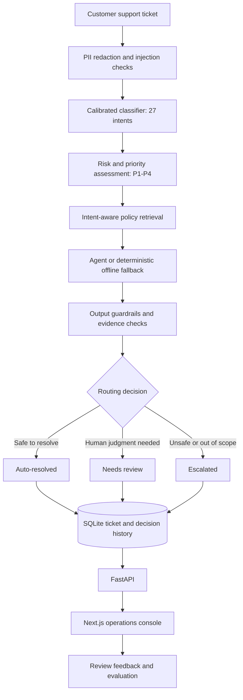

<div align="center">

# 🛟 TicketPilot

### AI customer support that knows when to answer — and when to hand off.

An end-to-end support automation project combining **calibrated intent classification, policy-aware retrieval, risk-based guardrails, and human-in-the-loop review**.

[](https://ticket-pilot-psi.vercel.app/)
[](https://ticketpilot-uy7z.onrender.com/docs)
[](https://github.com/srushti-lohiya/TicketPilot)

**Python · FastAPI · Next.js · TypeScript · Machine Learning · RAG · SQLite · Vercel · Render**

</div>

---

## ✨ At a glance



> **Live portfolio demo:** The public workspace uses fictional tickets and mock orders. Tickets are shared between visitors, may disappear when the free backend restarts, and never send real customer messages. Privileged approvals and order changes are disabled.

Customer-support automation has a harder problem than producing a fluent response: **deciding when it is safe to respond without human intervention**. A classifier can score almost perfectly on a templated benchmark and still struggle with messy, ambiguous, or unfamiliar requests.

TicketPilot treats automation as a decision under uncertainty. It classifies a ticket, retrieves supporting policy, checks risks, and routes the result to **auto-resolved**, **needs review**, or **escalated**. Its interface exposes the evidence and recorded decision checks instead of presenting a generated reply as unquestionable truth.

## 🚀 Live demo

| Resource | URL |
| --- | --- |
| Next.js operations console | [ticket-pilot-psi.vercel.app](https://ticket-pilot-psi.vercel.app/) |
| FastAPI health | [Backend `/health`](https://ticketpilot-uy7z.onrender.com/health) |
| Interactive API documentation | [Swagger `/docs`](https://ticketpilot-uy7z.onrender.com/docs) |
| Deployment instructions | [`docs/DEPLOYMENT.md`](docs/DEPLOYMENT.md) |

The frontend runs on **Vercel** and communicates with a **Render** FastAPI service. The hosted environment uses a deterministic fallback agent (no paid API key required) and lightweight TF-IDF retrieval. Render's free instance may need time to wake after inactivity.

## 🖥️ Product walkthrough

### 1. Ticket inbox and routing

Browse support requests, search or filter loaded tickets, and inspect recorded intent, priority, and routing status.



### 2. Explainable AI decisions

The ticket inspector presents **observable outputs**: predicted intent, confidence and threshold, risk signals, injection and PII checks, guardrail outcomes, and the suggested response. These are recorded decision artifacts—not a hidden model reasoning trace.



### 3. Policy retrieval evidence

Inspect the policies associated with a decision, the retrieval method, ranked evidence, and citations. In the hosted demo, retrieval uses a resource-efficient **TF-IDF word-and-character** encoder rather than the full local dense-retrieval setup.



### 4. Human-in-the-loop review

Tickets that cannot be safely auto-resolved are surfaced for review. **Public-demo approvals and label corrections are intentionally disabled**; protected actions require authorized access.



### 5. Evaluation lab

Compare the model's near-perfect benchmark results with its much weaker performance on realistic customer messages. The lab displays saved evaluation artifacts, not fabricated live metrics.



### 6. Safety and reliability

Explore recorded auto-resolution precision, out-of-scope handling, output-guardrail results, citation grounding, routing, and offline processing latency.



The console also includes **New Ticket** for submitting fictional requests and **Analytics** for workspace-level metrics. The public demo does not send customer messages or execute real order changes.

## 🧠 How it works



### Classification and calibrated abstention

A trained classifier predicts one of **27 support intents**. Confidence thresholds and policy/risk checks determine whether the system may auto-resolve or should defer to a human. A high score is **not proof that the answer is correct**.

### Retrieval configurations

- **Full local experiments:** BM25, dense retrieval, reciprocal rank fusion (RRF), intent-aware routing, and optional cross-encoder reranking.
- **Hosted demo:** Lightweight TF-IDF word + character retrieval, selected to fit the Render free-tier resource budget.

These are **different retrieval configurations**. Offline dense/hybrid benchmark results should not be mistaken for measurements of the hosted TF-IDF runtime.

### Agent and action boundaries

An optional Claude tool-use path can work with knowledge-base search, mock order lookup, refund-eligibility checks, cancellation rules, and escalation. A deterministic fallback keeps the project runnable and testable **without an LLM API key**.

**Checking refund eligibility is not issuing a refund.** Privileged actions are constrained by policy and approval requirements, and are disabled in the public demo.

## 📊 Evaluation: why accuracy alone is misleading

The numbers below describe **saved local evaluation artifacts**, not a guarantee of production accuracy or live hosted latency. Different evaluation panels use different subsets; denominators are shown where relevant.

### Benchmark versus realistic tickets

| Evaluation | Result |
| --- | ---: |
| Bitext benchmark accuracy (3,642 test samples) | **99.9%** |
| Benchmark macro F1 | **0.9989** |
| Realistic held-out in-scope accuracy (27 tickets) | **66.7%** |
| Out-of-scope tickets held from auto-resolution (12/12) | **100%** |

The larger hand-written realistic evaluation collection contains **66 tickets**, including out-of-scope cases. The gap between benchmark and realistic performance is a core motivation for abstention and review.

### End-to-end deterministic fallback evaluation

| Recorded metric | Result |
| --- | ---: |
| Tickets evaluated | 66 |
| Correct intent among auto-resolved tickets | **10/10 (100%)** |
| In-scope auto-resolution coverage | **10/54 (18.5%)** |
| Out-of-scope auto-resolved | **0/12** |
| Output guardrail pass | **56/59 (94.9%)** |
| Grounded citation rate | **35/51 (68.6%)** |
| Needs review | **49** |
| Escalated | **7** |
| Offline processing p50 / p95 | **14 ms / 153.2 ms** |

The recorded latency is for the **offline evaluation**, not customer wait time, hosted cold starts, or paid-LLM response time. Citation grounding here is measured by overlap with a reference policy-section ID; it does not prove every generated claim is supported. LLM-as-judge scores were **not measured** in the saved no-key evaluation.

### Retrieval comparison

Recorded **recall@3** from the project's local realistic-ticket retrieval experiments:

| BM25 | Dense | Hybrid (RRF) | Hybrid + intent routing |
| ---: | ---: | ---: | ---: |
| 0.61 | 0.69 | 0.65 | **0.85** |

In these experiments, **intent-aware routing** was more beneficial than simply combining retrieval methods.

> **Evaluation takeaway:** A strong benchmark score is useful, but safe automation also requires realistic tests, calibrated abstention, policy grounding, and human review.

## 🛡️ Engineering decisions

| Decision | Why it matters |
| --- | --- |
| Calibrated abstention | Weighs the cost of an incorrect automatic response rather than optimizing only for raw accuracy. |
| Intent-aware retrieval | Narrows supporting policy evidence to the customer's likely request. |
| PII and prompt-injection checks | Treats customer text as untrusted input. |
| Output guardrails | Checks for unsupported commitments and required evidence. |
| Human-in-the-loop routing | Defers ambiguous, high-risk, and out-of-scope cases. |
| Deterministic fallback | Keeps development, evaluation, and the hosted demo usable without paid inference. |
| Restricted public deployment | Prevents visitors from approving tickets or changing mock orders. |
| Evaluation provenance | Distinguishes saved experiments from current workspace metrics. |

## 🧰 Tech stack

| Layer | Technologies |
| --- | --- |
| Frontend | Next.js, TypeScript, Tailwind CSS, shadcn/ui |
| Backend | Python, FastAPI |
| Classification | Calibrated machine-learning intent classifier |
| Retrieval | BM25, dense retrieval, RRF, optional reranking; TF-IDF on Render |
| Agent | Optional Claude tool use; deterministic fallback |
| Persistence | SQLite; fictional help-center and order records |
| Testing and evaluation | Pytest, frontend E2E tests, lint, type checks, recorded evaluation reports |
| Hosting | Vercel + Render |

## 💻 Run locally

### 1. Clone and install the backend

```bash
git clone https://github.com/srushti-lohiya/TicketPilot.git
cd TicketPilot
python -m venv .venv
source .venv/bin/activate
pip install -r requirements.txt
```

### 2. Start the API

```bash
make api
```

API documentation: **http://127.0.0.1:8000/docs**

### 3. Start the Next.js console

In a second terminal, from the repository root:

```bash
cd frontend
npm install
npm run dev
```

Open **http://localhost:3000**. See [`frontend/README.md`](frontend/README.md) and [`docs/DEPLOYMENT.md`](docs/DEPLOYMENT.md) for backend URL and proxy configuration.

### 4. Reproduce experiments and tests

```bash
make all
```

The optional LLM path requires a separately configured provider key:

```bash
make eval-llm
```

The original Streamlit dashboard remains available with `make ui`; the **Next.js console is the deployed primary interface**. The repository's Docker Compose setup supports the original API/Streamlit workflow:

```bash
docker compose up --build
```

## ☁️ Deployment and demo limitations

| Component | Hosted behavior |
| --- | --- |
| Vercel | Next.js operations console and server-side backend proxy |
| Render | FastAPI service, trained classifier, lightweight TF-IDF retrieval |
| Data | Shared fictional demo tickets and mock orders in ephemeral local storage |
| Agent | Deterministic fallback; no paid LLM key required |
| Permissions | Privileged approvals, training-label corrections, and order-changing actions disabled |

**Important limitations:**

- **Ephemeral storage:** Tickets can disappear when the free backend restarts or redeploys.
- **Cold starts:** The Render service may be slow on its first request after inactivity.
- **Fictional data:** Nimbus Store, the policy knowledge base, and orders are mock data.
- **Limited evaluation scope:** The 66-ticket realistic collection is too small to support broad production generalizations.
- **No customer delivery:** An `auto_resolved` status in the demo does not mean an email was sent.
- **No live privileged actions:** The public demo is intentionally restricted.

Deployment instructions: [`docs/DEPLOYMENT.md`](docs/DEPLOYMENT.md).

## 📚 Data and responsible use

The classification work uses the **Bitext Customer Support dataset (CDLA-Sharing 1.0)**. The project's help-center policies and order records represent a fictional retailer. **Do not enter real customer information, credentials, or confidential order details into the public demo.**

## 📌 Project status

**Deployed portfolio demonstration.** The frontend and backend have been exercised together, including ticket creation, inspection, evaluation views, responsive layouts, and non-destructive authorization checks. The project demonstrates production-oriented engineering practices, but the free-hosted fictional workspace is **not a production-ready customer support service**.

---

<div align="center">

**When should an AI system act—and when should it ask for help?**

[Launch TicketPilot](https://ticket-pilot-psi.vercel.app/) · [Explore the API](https://ticketpilot-uy7z.onrender.com/docs) · [View source](https://github.com/srushti-lohiya/TicketPilot)

</div>
